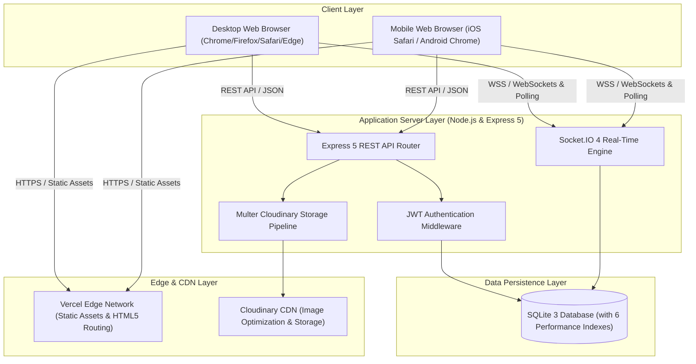
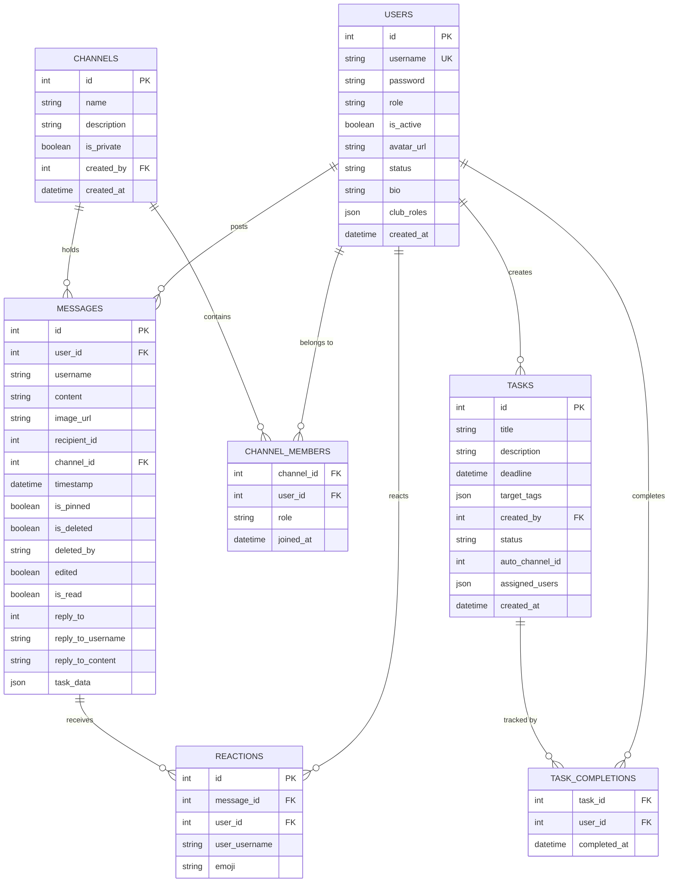

# System Architecture & Technical Specifications: NIC Messenger

---

## 1. High-Level System Architecture

---

## 2. Frontend Architecture

### 2.1 Component Tree & Responsibilities

- **`App.jsx`**:
  - Global authentication state (`token`, `user`, `role`, `userId`).
  - Active chat selection (`activeChat`: channel or DM user).
  - Socket.IO connection lifecycle (`connect`, `disconnect`, reconnect).
  - Sound chime audio synthesizer (Web Audio API oscillator).
  - Browser Notification API integrations.
  - Route navigation (`/login`, `/chat`, wildcard fallback).
- **`Chat.jsx`**:
  - Primary collaboration workspace layout.
  - Mobile responsive drawer navigation toggle.
  - Channels & Workflows list with urgency color coding (red/orange/yellow/green).
  - Direct Messaging contacts list with online/away/dnd status badges.
  - Search filter query input.
  - Modals trigger management.
- **`MessageList.jsx`**:
  - Virtual/scrollable message feed.
  - Immutable date separator calculation (`TODAY`, `YESTERDAY`, Date).
  - Interactive emoji reactions bar with unique counter badges.
  - Threaded reply context banners.
  - Workflow / Mission card render with "Mark Complete" action button.
  - Message edit and deletion triggers for owners and admins.
- **`SettingsModal.jsx`**:
  - Profile customization (avatar upload, bio/tagline, online status).
  - Theme Engine (Light, Dark, OLED Black).
  - Account security (password change, account termination).
  - Club hierarchy role management (Executive Board, Team Leads).
- **`TaskModal.jsx`**:
  - Workflow creation and editing.
  - Tag-based team targeting vs individual user targeting.
  - Future deadline validation and calendar picker.
- **`AnalyticsModal.jsx`**:
  - Task completion statistics and verified personnel roster.

---

## 3. Database Schema & Index Design

### 3.1 Optimized Database Indexes

1. `idx_messages_channel` on `messages(channel_id, timestamp DESC)`: Speeds up channel history loading and pagination.
2. `idx_messages_dm` on `messages(recipient_id, user_id, timestamp DESC)`: Speeds up 1-to-1 conversation history retrieval.
3. `idx_messages_user` on `messages(user_id)`: Speeds up user activity queries and deletion cascades.
4. `idx_channel_members_lookup` on `channel_members(channel_id, user_id)`: Speeds up room membership verification and permission checks.
5. `idx_reactions_message` on `reactions(message_id)`: Speeds up emoji reaction lookups.
6. `idx_tasks_auto_channel` on `tasks(auto_channel_id)`: Speeds up task-channel binding lookups.

---

## 4. Real-Time Protocol Specification

| Event Name | Direction | Payload | Description |
|---|---|---|---|
| `switch chat` | Client -> Server | `{ recipientId, channelId }` | Fetches recent history for the selected channel or DM. |
| `fetch older messages` | Client -> Server | `{ recipientId, channelId, offset }` | Paginates archive messages in chunks of 50. |
| `chat message` | Client <-> Server | `{ channelId, recipientId, content, imageUrl }` | Dispatches message to channel room or direct socket. |
| `reply to message` | Client <-> Server | `{ messageId, content, replyToUsername, ... }` | Dispatches threaded message reply. |
| `edit message` | Client <-> Server | `{ messageId, content }` | Updates message content with `edited: true`. |
| `delete message` | Client <-> Server | `messageId` | Soft deletes message with tombstone marker. |
| `add reaction` | Client <-> Server | `{ messageId, emoji }` | Toggles emoji reaction on targeted message. |
| `typing start` / `stop` | Client <-> Server | `{ channelId, recipientId }` | Scoped typing notification to active view. |
| `create task` | Client -> Server | `{ title, description, deadline, ... }` | Creates task and auto-generates dedicated channel. |
| `complete task` | Client -> Server | `messageId` | Logs user task completion and updates channel progress. |
| `delete task` | Client -> Server | `{ taskId }` | Deletes task and dissociates auto-generated channel. |
